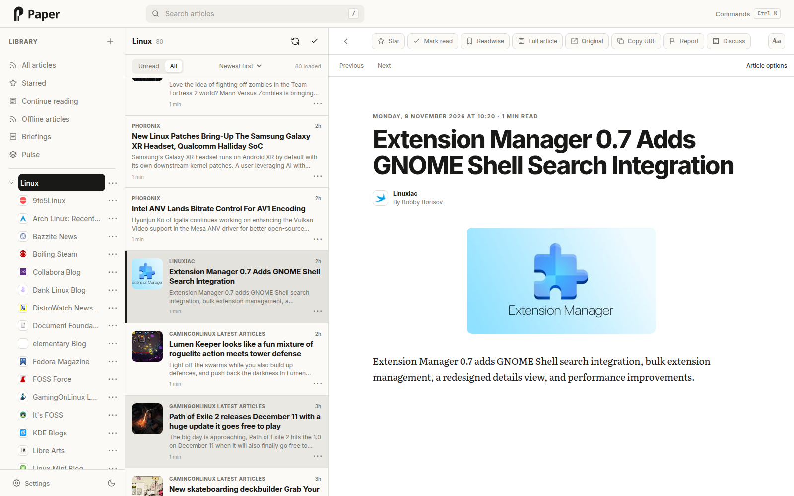
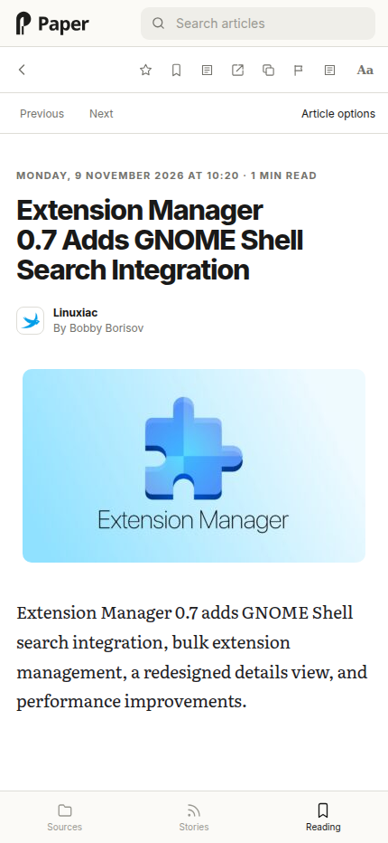

# Paper

A self-hosted feed reader with full-text articles, search, filters, keyboard
shortcuts, and offline reading. Works on desktop and mobile. Run Paper on its own
or connect it to FreshRSS or Miniflux to share subscriptions, read state, and stars.

Entirely AI-coded. If this steals kittens, don't blame me.

Paper 0.2.0-alpha.3 is an alpha release for single-user use. Built-in login
is optional and starts off. Keep it local until you enable login or an
[authenticated HTTPS proxy](docs/access.md) for remote access.
See the [changelog](CHANGELOG.md) for 0.2.0-alpha.3 changes and upgrade notes.

<picture>
  <source media="(prefers-color-scheme: dark)" srcset="docs/screenshots/desktop-dark.png">
  
</picture>

<details>
<summary>Mobile view</summary>



</details>

## Quick start

Start new installations in standalone mode. For an existing installation, follow
the [upgrade guide](docs/recovery.md#upgrade-from-020-alpha1-to-020-alpha2).

You need Docker Compose 2.24.4 or newer. The 0.2.0-alpha.3 images support Linux amd64.
On a Raspberry Pi 4 or 5 with a 64-bit OS, or another Linux ARM64 server,
[build from source](#build-from-source) until the first ARM64 release.
Standalone mode needs one Paper container and a persistent data directory. No
FreshRSS or optional integration credentials are needed.

```sh
git clone --branch v0.2.0-alpha.3 --depth 1 https://github.com/cliophate/paper-reader.git
cd paper-reader
sh scripts/setup.sh
sh scripts/pull-image.sh
docker compose up -d --no-build paper
```

The helper pulls the pinned runtime image from GHCR. If the registry is
unavailable, it downloads the release image archive, verifies its SHA-256
checksum, and loads it into Docker.

Setup creates private configuration with `PAPER_BACKEND=standalone`. Open
[localhost:8080](http://localhost:8080), choose **+ > Add feed** in the sidebar,
and add an RSS or Atom feed, discover a feed from a website, or preview an OPML
import. Paper fetches active feeds automatically. The default interval after a
successful fetch is 15 minutes; `Retry-After` and failure backoff can delay the next fetch. Paper
checks for due feeds every second. **Reload articles** shows what Paper already
has. To request an upstream check, open **Settings > Feeds > Manage feeds** and
select a feed for **Check now**. Open **Feed checks and intervals** to check a
folder or change the default interval. Each feed can override that interval,
from 5 minutes to one day. Manual checks respect publisher delays and a
one-minute cooldown. Search and reading state work immediately.

Paper saves feed icons in the background. If you migrated from FreshRSS, keep
it running until Paper has copied the icons you want to preserve. For a private
FreshRSS address, include its exact origin in `PAPER_TRUSTED_FEED_ORIGINS` while
Paper copies the icons. Set `PUBLIC_URL` to the address you use to open Paper so
Reader apps can load the saved icons too.

Use the sidebar **+** menu to add a feed or create a standalone folder. Select
the **Edit feeds** pencil to show drag grips, selection checkboxes and row options.
Changes save immediately; **Done** leaves edit mode. Row options support rename,
move and confirmed unsubscribe. Standalone also supports folder management and
ordering; FreshRSS and Miniflux offer their supported feed operations. See
[sidebar controls](docs/organization.md#sidebar-controls).

For a source image outside Compose, set `PAPER_BACKEND=standalone`, mount a
persistent volume at `/data`, and publish port 8080 to loopback. Paper creates
private internal and signing secrets on first start. Keep the volume when
recreating the container.

### Optional owner login

Open **Settings > Access** to enable login with a
username, password and setup code. The server prints a code at startup while
no owner exists. It expires after 15 minutes. To get a replacement, run
`docker compose exec paper npm run paper-auth -- setup-code`.
Add passkeys, manage sessions and create app passwords in the same settings.
Use HTTPS for remote access. An existing authenticated proxy can stay in place.
See [access and recovery](docs/access.md) before exposing Paper.

Standalone installs can enable [Reader apps](docs/greader-api.md) for Google
Reader-compatible sync. Access starts disabled and requires app passwords.

### FreshRSS mode

Set `PAPER_BACKEND=freshrss` and provide `FRESHRSS_BASE_URL`, `FRESHRSS_USERNAME`
and `FRESHRSS_API_PASSWORD` in your private configuration. Enable FreshRSS's
Google Reader API and use its separate API password. Paper imports your archive
in the background; search becomes available after that initial import.

Existing installations that omit `PAPER_BACKEND` retain FreshRSS behavior.
FreshRSS must be reachable from Paper's container. `localhost` inside the
container refers to Paper itself. Use a shared Docker network or reachable URL.

The database binds to one backend instance. Changing the backend or FreshRSS
account in configuration does not transfer its data. Use a separate data directory
for a different backend or account. Settings > Backend & data shows the current mode.

### Miniflux mode

Native Miniflux support is available in source builds containing this change;
use the build-from-source instructions below.

Start with a new Paper data directory and Miniflux **2.3.2 or newer**. Set
`PAPER_BACKEND=miniflux`, `MINIFLUX_BASE_URL` and `MINIFLUX_API_KEY` in private
configuration. Generate a dedicated key in Miniflux **Settings > API Keys**.
The URL is the server root, including any subpath, without `/v1` at the end.
FreshRSS credentials are unnecessary in this mode. Paper uses Miniflux's native
API directly.

Paper imports articles and synchronizes read state and stars in both directions.
Miniflux continues fetching feeds. Paper's **Refresh** imports Miniflux's current
data; it does not force publishers to be fetched. Add, rename, move and
unsubscribe are supported. Choose a real category when moving a feed; adding
without one uses Miniflux's default category. Category management, reordering
and feed URL repair are currently unavailable in Paper.

Miniflux must be reachable when Paper or its briefing CLI starts. Existing
cached articles remain readable during a later outage. Token rotation preserves
the account binding. A different server, account or backend needs a separate
data directory.
See [Miniflux setup and behavior](docs/miniflux.md).

To use a different local port, change `PAPER_PORT` and `PUBLIC_URL` in `.env`.
For access from other devices, follow the [remote access guide](docs/access.md).

## Optional connections

Open **Settings > Reading & connections** to enable:

- AI discussions, headline cleanup, Pulse story grouping, and briefings.
- Scheduled morning and evening briefing emails using your SMTP relay.
- Readwise Reader saves.
- Kirby note drafts through a compatible publishing plugin.

Each connection has setup instructions. Readwise and Kirby tokens can be saved
in Settings. AI supports an OpenAI-compatible API or the isolated Codex worker
with a ChatGPT login. See [AI providers](docs/ai-providers.md) for setup. AI installs
from before alpha.4 must follow the
[worker upgrade steps](docs/integrations.md#upgrade-an-existing-ai-installation).
Reading works without any of these connections.

Briefing email starts off. Enter your SMTP details under **Briefing email** and
send a test before saving. If you use n8n or another scheduler, disable that
workflow before turning on **Send scheduled briefings**.

See the [integration guide](docs/integrations.md) for full setup instructions.

## Pulse collections

Pulse starts a collection when at least three articles from two or more publication
domains cover the same story within seven days. Later reporting can join an existing
collection at any time.

**Active** shows stories that at least two publications covered in the past 72 hours.
It shows 25 collections first, ranked by recent publications and articles, then by
unread count and publication time. The lead card goes to the visible collection
with the most articles added since your last visit. **Quiet** holds stories with
less recent coverage. **Unread** shows active and quiet collections that contain
unread articles. **Small** lists collections with fewer than
three visible articles or fewer than two publications.

When the newest article is more than seven days old, the collection moves to the
archive. Open it from the bottom of Quiet or follow a saved link. Adding an old
article counts as new since your visit, but only its publication date counts
toward activity. Articles without a publication date never count toward activity.

## Your data

Back up `./data` and your private `.env`. The data directory holds reading
positions, discussions, filters, saved briefings, and any connection tokens
entered in Settings and generated signing secrets. The database also contains owner credentials,
passkeys, sessions and app-password revocation state. Reader app credentials can
exist with owner login off. Standalone
subscriptions and article state also live there. With a remote backend, back up
FreshRSS or Miniflux separately. Optional [retention settings](docs/retention.md) can mark
old articles read, delete unprotected articles and clean cached full text. All
limits start off. Paper backs up before its first article deletion.

See [backup, restore, and upgrades](docs/recovery.md) before updating Paper,
and [security and privacy](SECURITY.md) for details about stored data and
external services.

## Limits

This is an alpha release. Keep backups before upgrading. Folders are flat, and OPML
transfers subscriptions, not article history or settings. Offline browser copies
are not server backups and do not protect server articles from retention. Star
articles to keep their server copies. Cleanup frees database pages for reuse;
it does not shrink the file or remove backups. Identity conflicts have no dedicated resolution UI.
Broad searches can still take time, although they run outside the HTTP event
loop. Article cleanup avoids known repeated-markup scans; very deep or large
HTML still has a processing cost.

## Build from source

The reader and optional Codex worker support Linux amd64 and arm64.
For a library around 200,000 articles, budget 1 GiB of RAM for Paper plus
memory for the OS and any other containers. The Reader API scale test checks
that the peak RSS of Paper and its child processes stays below 1 GiB.

Clone the repository at the tag or commit you want to build, then run
`sh scripts/setup.sh` if you do not already have private configuration. From
that checkout:

```sh
docker compose build paper
docker compose up -d --no-build paper
```

For local development and tests, see the [development guide](docs/development.md).

## License

[MIT](LICENSE). Third-party components retain their own licenses, listed in
[third-party notices](THIRD_PARTY_NOTICES.md).
