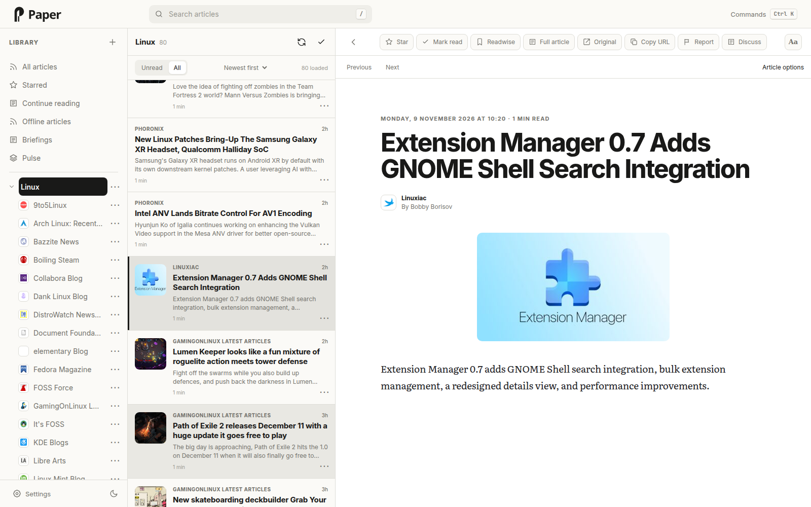
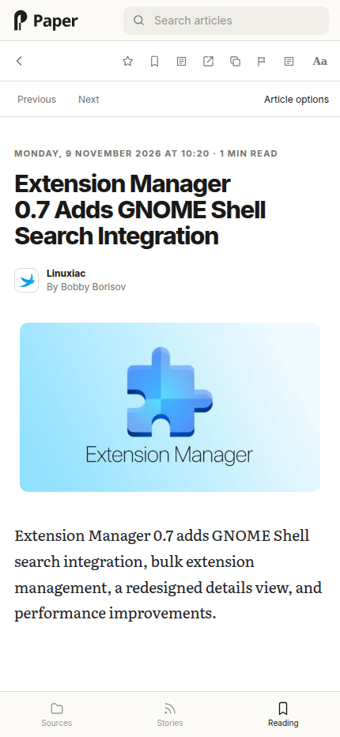

# Paper

A self-hosted feed reader with full-text articles, search, filters, keyboard
shortcuts, and offline reading. Works on desktop and mobile. Run Paper on its own
or connect it to FreshRSS to share subscriptions, read state, and stars.

Entirely AI-coded. If this steals kittens, don't blame me.

Paper 0.2.0-alpha.1 is an alpha release for single-user use. It has no
built-in login. Keep it local or use an [authenticated HTTPS proxy](docs/access.md) for remote access.
See the [changelog](CHANGELOG.md) for 0.2.0-alpha.1 changes and upgrade notes.

<picture>
  <source media="(prefers-color-scheme: dark)" srcset="docs/screenshots/desktop-dark.png">
  
</picture>

<details>
<summary>Mobile view</summary>



</details>

## Quick start

Start new installations in standalone mode. For an existing installation, follow
the [upgrade guide](docs/recovery.md#upgrade-from-010-to-020-alpha1).

You need Docker Compose 2.24.4 or newer. The 0.2.0-alpha.1 images support Linux amd64.
Standalone mode needs one Paper container and a persistent data directory. No
FreshRSS or optional integration credentials are needed.

```sh
git clone --branch v0.2.0-alpha.1 --depth 1 https://github.com/cliophate/paper-reader.git
cd paper-reader
sh scripts/setup.sh
sh scripts/pull-image.sh
docker compose up -d --no-build paper
```

The helper pulls the pinned runtime image from GHCR. If the registry is
unavailable, it downloads the release image archive, verifies its SHA-256
checksum, and loads it into Docker.

Setup creates private configuration with `PAPER_BACKEND=standalone`. Open
[localhost:8080](http://localhost:8080), choose **+ > Add feed** in the sidebar,
and add an RSS or Atom feed, discover a feed from a website, or preview an OPML
import. Paper fetches active feeds automatically. The default interval after a
successful fetch is 15 minutes; `Retry-After` and failure backoff can delay the next fetch. Paper
checks for due feeds every second. **Reload articles** shows what Paper already
has. To request an upstream check, open **Settings > Feeds > Manage feeds** and
select a feed for **Check now**. Open **Feed checks and intervals** to check a
folder or change the default interval. Each feed can override that interval,
from 5 minutes to one day. Manual checks respect publisher delays and a
one-minute cooldown. Search and reading state work immediately.

Use the sidebar **+** menu to add a feed or create a standalone folder. Select
the **Edit feeds** pencil to show drag grips, selection checkboxes and row options.
Changes save immediately; **Done** leaves edit mode. Row options support rename,
move and confirmed unsubscribe. Standalone also supports folder management and
ordering; FreshRSS offers its supported feed operations. See
[sidebar controls](docs/organization.md#sidebar-controls).

For a source image outside Compose, set `PAPER_BACKEND=standalone`, mount a
persistent volume at `/data`, and publish port 8080 to loopback. Paper creates
private internal and signing secrets on first start. Keep the volume when
recreating the container.

### FreshRSS mode

Set `PAPER_BACKEND=freshrss` and provide `FRESHRSS_BASE_URL`, `FRESHRSS_USERNAME`
and `FRESHRSS_API_PASSWORD` in your private configuration. Enable FreshRSS's
Google Reader API and use its separate API password. Paper imports your archive
in the background; search becomes available after that initial import.

Existing installations that omit `PAPER_BACKEND` retain FreshRSS behavior.
FreshRSS must be reachable from Paper's container. `localhost` inside the
container refers to Paper itself. Use a shared Docker network or reachable URL.

The database binds to one backend instance. Changing the backend or FreshRSS
account in configuration does not transfer its data. Use a separate data directory
for a different backend or account. Settings > Backend & data shows the current mode.

To use a different local port, change `PAPER_PORT` and `PUBLIC_URL` in `.env`.
For access from other devices, follow the [remote access guide](docs/access.md).

## Optional connections

Open **Settings > Reading & connections** to enable:

- AI discussions, headline cleanup, Pulse story grouping, and briefings.
- Readwise Reader saves.
- Kirby note drafts through a compatible publishing plugin.

Each connection has setup instructions. Readwise and Kirby tokens can be saved
in Settings. AI supports an OpenAI-compatible API or the isolated Codex worker
with a ChatGPT login. See [AI providers](docs/ai-providers.md) for setup. AI installs
from before alpha.4 must follow the
[worker upgrade steps](docs/integrations.md#upgrade-an-existing-ai-installation).
Reading works without any of these connections.

See the [integration guide](docs/integrations.md) for full setup instructions.

## Your data

Back up `./data` and your private `.env`. The data directory holds reading
positions, discussions, filters, saved briefings, and any connection tokens
entered in Settings and generated signing secrets. Standalone
subscriptions and article state also live there. In FreshRSS mode, back up
FreshRSS separately. Optional [retention settings](docs/retention.md) can mark
old articles read, delete unprotected articles and clean cached full text. All
limits start off. Paper backs up before its first article deletion.

See [backup, restore, and upgrades](docs/recovery.md) before updating Paper,
and [security and privacy](SECURITY.md) for details about stored data and
external services.

## Limits

This is an alpha release. Keep backups before upgrading. Folders are flat, and OPML
transfers subscriptions, not article history or settings. Offline browser copies
are not server backups and do not protect server articles from retention. Star
articles to keep their server copies. Cleanup frees database pages for reuse;
it does not shrink the file or remove backups. Identity conflicts have no dedicated resolution UI.
Broad searches can still take time, although they run outside the HTTP event
loop. Article cleanup avoids known repeated-markup scans; very deep or large
HTML still has a processing cost.

## Build from source

Clone the repository at the tag or commit you want to build, then run
`sh scripts/setup.sh` if you do not already have private configuration. From
that checkout:

```sh
docker compose build paper
docker compose up -d --no-build paper
```

For local development and tests, see the [development guide](docs/development.md).

## License

[MIT](LICENSE). Third-party components retain their own licenses, listed in
[third-party notices](THIRD_PARTY_NOTICES.md).
